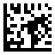
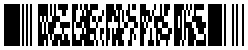
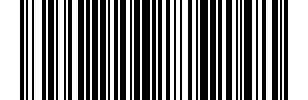
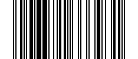
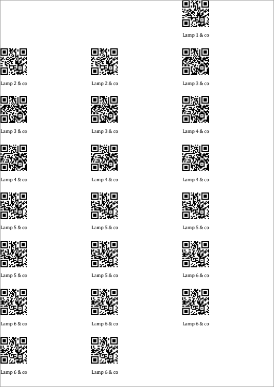
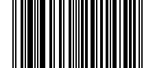
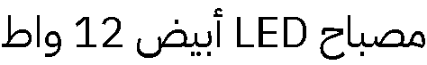

# qrbar-cli

Print barcode and QR code labels from the command line. Point it at a
**template** (Word `.docx`, or Zebra `.zpl` / `.prn`) and your **data** (Excel or
JSON), and get label sheets, one label per page, or ZPL ready for the printer.
Word output can also be saved as PDF.

<p>
  
  
  
  
  
  
</p>

```bash
qrbar render -t label.zpl -d items.xlsx
```


- **Templates decide the look.** `{{ qr(item.url, size_mm=25) }}` in the template
  picks the code type and its printed size. The data only carries values.
- **Word or Zebra, same syntax.** In Word a code becomes an image sized in mm. In
  ZPL it becomes the printer's own command (`^BQ`, `^BC`, `^BX`, ...).
- **Quantities built in.** A `qty` column per row: copies in Word, `^PQ` in ZPL.
- **Label sheets** like A4 3 x 8, with `--skip` to reuse a partly used sheet.
- **Arabic on Zebra printers.** Shaped, right-to-left text is drawn as a graphic,
  because label printers cannot join Arabic letters.
- **Excel, JSON, or typed in.** Order and filter rows before printing. With
  `--schema`, the CLI asks for the records interactively instead of reading a file.
- **Safe by default.** Existing files and the template are never overwritten
  without `--force`. Bad data is reported by row, and nothing is written.

**Documentation: [aaltatan.github.io/qrbar-cli](https://aaltatan.github.io/qrbar-cli/)**:
a step-by-step guide, real-world recipes and the full reference.

Built on the [qrbar](https://github.com/aaltatan/qrbar) library. Data is read with
[pyrecords](https://github.com/aaltatan/pyrecords), the same reader
[templify](https://github.com/aaltatan/templify) uses.

## Contents

- [Installation](#installation)
- [Quick start](#quick-start)
- [Commands](#commands)
  - [`render` (`r`)](#render-r)
  - [`code` (`c`)](#code-c)
  - [`symbologies` (`s`)](#symbologies-s)
- [Writing templates](#writing-templates)
  - [ZPL / PRN](#zpl--prn)
  - [Word (docx)](#word-docx)
  - [Label sheets](#label-sheets)
- [Data](#data)
  - [Quantities](#quantities)
  - [Order and filter](#order-and-filter)
  - [Typing the data in (`--schema`)](#typing-the-data-in---schema)
- [Output modes](#output-modes)
- [Arabic labels](#arabic-labels)
- [PDF](#pdf)
- [Recipes](#recipes)
- [Errors and exit codes](#errors-and-exit-codes)
- [Option reference](#option-reference)
- [Development](#development)
- [License](#license)

---

## Installation

```bash
uv tool install qrbar-cli
```

```bash
pipx install qrbar-cli
```

This installs the `qrbar` command. It needs Python 3.12 or newer. Everything else,
including Arabic shaping, installs as prebuilt wheels. For `--pdf` you also need
[LibreOffice](https://www.libreoffice.org).

---

## Quick start

The [`examples/`](examples) folder has templates and data for every command in
this README. Run these from inside it:

| File | What it is |
|------|------------|
| [`items.xlsx`](examples/items.xlsx) / [`items.json`](examples/items.json) | 4 products: `url`, `sku`, `ean`, `name`, `name_ar`, `category`, `qty` |
| [`label.zpl`](examples/label.zpl) | A 203 dpi Zebra label: QR, Code 128, EAN-13 and a name |
| [`arabic.zpl`](examples/arabic.zpl) | A Zebra label with an Arabic name |
| [`label.docx`](examples/label.docx) | A 60 x 40 mm Word label, one per page |
| [`sheet.docx`](examples/sheet.docx) | An A4 sheet of 3 x 8 stickers (70 x 37 mm) |
| [`small.zpl`](examples/small.zpl) | A small Zebra label: Code 128 and a name |
| [`item.schema.json`](examples/item.schema.json) | A JSON Schema to type records in |

```bash
# Zebra labels for every row of the sheet
qrbar render -t label.zpl -d items.xlsx

# an A4 sticker sheet, the first 4 stickers already used
qrbar render -t sheet.docx -d items.xlsx -m sheet --rows 8 --cols 3 --skip 4

# one image
qrbar code qr "https://example.com/p/1"
```

```text
Written: .../examples/label-labels.zpl
Written: .../examples/sheet-labels.docx
Written: .../examples/qr.png
```



---

## Commands

```text
qrbar --help
qrbar <command> --help
qrbar --version          # qrbar-cli 0.1.0 (qrbar 0.1.0)
```

| Command | Alias | Does |
|---------|-------|------|
| `render` | `r` | Template + data → labels (`.docx`, `.zpl`, `.prn`, `.pdf`) |
| `code` | `c` | One barcode / QR image (`.png`, `.svg`) |
| `symbologies` | `s` | List the code types and what each one accepts |

### `render` (`r`)

```text
qrbar render -t <template> (-d <data> | -s <schema>) [options]
```

The template type comes from its extension: `.docx` is Word, `.zpl` or `.prn` is
ZPL. By default it writes one file named `<template>-labels.<ext>` in the current
folder:

```bash
qrbar render -t label.zpl -d items.xlsx                 # label-labels.zpl
qrbar render -t label.docx -d items.json -f today -o out  # out/today.docx
```

### `code` (`c`)

```text
qrbar code <symbology> <payload> [-o file] [--format png|svg] [--scale N]
```

```bash
qrbar code qr "https://example.com/p/1"              # qr.png
qrbar code ean13 400638133393 -o ean.svg             # SVG, from the extension
qrbar code datamatrix LMP-001 --scale 10 -o dm.png   # 10 px per module
qrbar code qr "مصباح مكتب" -o arabic-qr.png          # UTF-8, Arabic works
qrbar c pdf417 "LMP-001 Desk lamp" --format svg      # pdf417.svg
```


`--scale` is PNG pixels per module (one QR square, or the thinnest bar), 4 by
default. An SVG scales by itself.

### `symbologies` (`s`)

```bash
qrbar symbologies
```

```text
 Name        Payload
 aztec       Any text, UTF-8
 code128     ASCII only
 datamatrix  Any text, UTF-8; always square
 ean13       12 digits (check digit added) or 13 (verified)
 pdf417      Any text, UTF-8
 qr          Any text, UTF-8 (Arabic works)
 upca        11 digits, or 12 with a correct check digit
```

| Code | Example | Image |
|------|---------|-------|
| `qr` | `https://example.com/p/1` |  |
| `datamatrix` | `LMP-001` |  |
| `aztec` | `https://example.com/p/1` |  |
| `pdf417` | `LMP-001 Desk lamp` |  |
| `code128` | `LMP-001` |  |
| `ean13` | `400638133393` |  |
| `upca` | `03600029145` |  |

---

## Writing templates

Templates use [Jinja](https://jinja.palletsprojects.com) with one function per
code type: `qr()`, `code128()`, `ean13()`, `upca()`, `datamatrix()`, `pdf417()`,
`aztec()`, plus `barcode(name, ...)` and, in ZPL, `text()`. Each takes the
payload and an optional size in mm: `size_mm` (QR and Data Matrix),
`width_mm`, `height_mm`. The full template guide is in the
[qrbar README](https://github.com/aaltatan/qrbar#readme). The basics follow.

### ZPL / PRN

A ZPL template is **one label** (`^XA ... ^XZ`). It is rendered once per row,
and the row is available as `item`. Positions (`^FO`) and fonts are up to you.
qrbar fills in the codes. This is [`examples/label.zpl`](examples/label.zpl):

```text

^XA
^FO50,50{{ qr(item.url, size_mm=25) }}
^FO50,300{{ code128(item.sku, width_mm=40, height_mm=10) }}
^FO50,450{{ ean13(item.ean) }}
^FO50,600^A0N,30,30^FD{{ item.name }}^FS
^XZ
```

```bash
qrbar render -t label.zpl -d items.xlsx
```

```text
^XA^CI28
^FO50,50^BQN,2,8^FH_^FDMA,https://example.com/p/1^FS
^FO50,300^BY2^BCN,80,N,N,N,A^FH_^FDLMP-001^FS
^FO50,450^BY2^BEN,100,N,N^FH_^FD400638133393^FS
^FO50,600^A0N,30,30^FDDesk lamp^FS
^PQ3^XZ
^XA^CI28
...
```

What happens to the template:

- `^CI28` (UTF-8) is added after `^XA`, and `^PQ<qty>` before `^XZ`. A row with
  `qty` 3 is **one block printed 3 times**, so do not put `^PQ` in the template.
- Sizes in mm are converted to dots using `dpi`, 203 by default. For a 300 dpi
  printer, start with ``.
- Data containing `^` or `~` in a plain `{{ item.name }}` is refused, so a value
  cannot inject printer commands. Use `{{ text(item.name) }}` for free text.
- A typo like `item.nmae` is an error naming the row, not an empty field.

### Word (docx)

Write the template in Word using the same functions. Codes become images sized
in mm. Loops use [docxtpl](https://docxtpl.readthedocs.io) tags (`` for
paragraphs, `` for table rows). [`examples/label.docx`](examples/label.docx)
is a 60 x 40 mm page:

```text

{{ code128(item.sku, width_mm=50, height_mm=12) }}
{{ item.name }}

<page break>


```

```bash
qrbar render -t label.docx -d items.json      # 9 pages: 3 + 1 + 5 copies, qty 0 skipped
```

A size is the code itself, without its white margin, so leave a few mm of space
around each code.

### Label sheets

For sheets like A4 3 x 8, the CLI splits the copies into `pages → rows → cells`.
The template loops over them, and an empty position is `None`.
[`examples/sheet.docx`](examples/sheet.docx) has one table row of three
70 x 37 mm cells:

```text

┌─────────────────────────┬─────────────────────┬─────────────────────┐
│                                              │
├─────────────────────────┼─────────────────────┼─────────────────────┤
│          │  ... │  ... │
│ {{ qr(row[0].url,       │                     │                     │
│       size_mm=20) }}    │                     │                     │
│ {{ row[0].name }}       │                     │                     │
│              │                     │                     │
├─────────────────────────┼─────────────────────┼─────────────────────┤
│                                                       │
└─────────────────────────┴─────────────────────┴─────────────────────┘
 <page break> 

```

```bash
# 9 stickers on one A4 sheet
qrbar render -t sheet.docx -d items.xlsx -m sheet --rows 8 --cols 3

# the first 4 stickers were peeled off already
qrbar render -t sheet.docx -d items.xlsx -m sheet --rows 8 --cols 3 --skip 4

# every product starts on its own sheet; empty stickers fill the rest
qrbar render -t sheet.docx -d items.xlsx -m sheet --rows 8 --cols 3 --new-page-per-record --fill-last

# A, B, C, A, B, C ... instead of A, A, A, B, C ...
qrbar render -t sheet.docx -d items.xlsx -m sheet --rows 8 --cols 3 --collate interleaved
```


| Option | Effect |
|--------|--------|
| `--rows`, `--cols` | The sheet grid (required with `-m sheet`) |
| `--skip N` | Leave the first N positions empty |
| `--fill-last` | Pad the last sheet with empty positions |
| `--new-page-per-record` | Each row's copies start on a new sheet |
| `--collate grouped\|interleaved` | Copy order: `A A B B` (default) or `A B A B` |

---

## Data

| Source | Format |
|--------|--------|
| `-d items.xlsx` | The active sheet. The first row holds the column names, and each following row is one label. Blank rows are skipped, and formulas give their last saved value. |
| `-d items.json` | A list of objects: `[{"sku": "LMP-001", ...}, ...]` |
| `-s item.schema.json` | Ask for the records interactively ([below](#typing-the-data-in---schema)) |

Columns are available in the template as `item.<column>` (or `row[i].<column>` in
sheets). A column name with spaces is `item["unit price"]`.

### Quantities

The `qty` column sets how many copies of a row to print:

| `qty` | Copies |
|-------|--------|
| missing, empty | 1 |
| `3`, `"3"`, `3.0` | 3 |
| `0` | none, the row is skipped |
| `-1`, `2.5`, `"three"`, `true` | error naming the row |

```bash
qrbar render -t label.zpl -d items.json --qty-field copies   # use another column
qrbar render -t label.zpl -d items.json --max-copies 0       # lift the 10 000-copy safety limit
```

The default limit of 10 000 copies per run stops a typo like `qty = 100000` from
sending a huge job. A run over the limit writes nothing:

```text
$ qrbar render -t label.zpl -d items.json --max-copies 5
Error: 9 copies requested, more than max_copies=5.
```

### Order and filter

These run before rendering, in this order: **order → filter → render**.

```bash
# by category, then by name descending
qrbar render -t label.docx -d items.xlsx --order category --order -name

# only lighting products, into lighting.docx
qrbar render -t label.docx -d items.json -f lighting \
  --filter '{"name": "string__eq", "args": ["category", "lighting"], "kwargs": {}, "inverse": false}'

# everything except cables, SKUs A to Z
qrbar render -t label.zpl -d items.json --order sku -f no-cables \
  --filter '{"name": "string__eq", "args": ["category", "cables"], "kwargs": {}, "inverse": true}'
```

`--filter` takes pyrecords' JSON filter language (the same as templify's), with 50+ rules for
strings, numbers, dates and more. Rules combine with `all` / `any`:

```bash
qrbar render -t label.zpl -d items.json -f bulbs-or-floor --filter '{
  "operator": "any",
  "expressions": [
    {"name": "string__eq", "args": ["category", "bulbs"], "kwargs": {}, "inverse": false},
    {"name": "string__icontains", "args": ["name", "floor"], "kwargs": {}, "inverse": false}
  ]
}'
```

Every rule and its arguments are listed in
[templify's filter guide](https://github.com/aaltatan/templify#filtering), or run
`templify filters` if you have templify installed.

> **PowerShell** quotes JSON differently: wrap it in single quotes and double
> every inner `"`, or put the filter in a variable first.

### Typing the data in (`--schema`)

There is no data file for a one-off label? Give a JSON Schema, and the CLI asks
for each record, using [schemify](https://github.com/aaltatan/schemify):

```text
$ qrbar render -t small.zpl -s item.schema.json
Item 1
? SKU: LMP-009
? Name: Wall lamp
? Copies: 2

? Add another item? (1 so far) No
Written: .../small-labels.zpl
```


The questions follow the schema's fields, titles and types, and the answers are
checked against it. Option mistakes are reported **before** the first question.
[`examples/item.schema.json`](examples/item.schema.json) asks for `sku`, `name` and
`qty` (shown as "Copies").

---

## Output modes

| `-m / --mode` | Writes | Works with |
|---------------|--------|------------|
| `paged` (default) | One file: one label per copy (ZPL: one block per row with `^PQ`) | docx, ZPL |
| `sheet` | One docx of label sheets | docx |
| `per_item` | One file per row | docx, ZPL |

```bash
# one file per product, named by SKU: LMP-001.zpl, LMP-002.zpl, BLB-010.zpl
qrbar render -t label.zpl -d items.json -m per_item -n sku -o zebra

# numbered: "1 - Desk lamp.docx", "2 - Floor lamp.docx", "3 - LED bulb.docx"
qrbar render -t label.docx -d items.xlsx -m per_item -n name --numbered -o word

# no --name-by: label-1.zpl, label-2.zpl, label-3.zpl (the row number)
qrbar render -t label.zpl -d items.json -m per_item -o rows
```


File names:

- `paged` / `sheet`: `-f/--filename`, by default `<template>-labels`.
- `per_item`: `-n/--name-by <column>`, by default `<template>-<row>`. Rows with
  `qty 0` write nothing.
- Characters that are invalid in file names (`/ \ : * ? " < > |`) become `_`.
  A value like `../x` cannot write outside `-o`.
- Two rows that give the same name are refused, so one never silently replaces
  the other.
- An existing file stops the run before anything is written. Use `--force` to
  replace it. The template itself is never replaced.

---

## Arabic labels

Zebra printers cannot join Arabic letters, so `text()` in a ZPL template draws
Arabic as a graphic (`^GF`), shaped and right to left. Latin text stays a
normal printer font. [`examples/arabic.zpl`](examples/arabic.zpl):

```text

^XA
^FO40,30{{ text(item.name_ar, size_mm=5) }}
^FO40,110{{ qr(item.url, size_mm=20) }}
^FO260,140^A0N,30,30^FD{{ item.sku }}^FS
^XZ
```



```bash
qrbar render -t arabic.zpl -d items.json
```

The bundled font is IBM Plex Sans Arabic. Use your own with `--font`:

```text
qrbar render -t arabic.zpl -d items.json --font "C:/Windows/Fonts/tahoma.ttf"
```

In Word templates, Arabic just works: Word does the shaping, using the
document's own fonts.

---

## PDF

`--pdf` converts the Word output with LibreOffice, so you get `.pdf` files instead
of `.docx`. It works in every mode:

```text
$ qrbar render -t sheet.docx -d items.xlsx -m sheet --rows 8 --cols 3 --pdf
Written: .../sheet-labels.pdf

$ qrbar render -t label.docx -d items.json -m per_item -n sku --pdf
3 files written to: ...
```

LibreOffice is found on `PATH` or in its default install folder. Otherwise point
to it:

```text
$ qrbar render -t label.docx -d items.json --pdf --soffice "D:/Apps/LibreOffice/program/soffice.exe"
```

---

## Recipes

**Send ZPL straight to a Zebra printer**

```text
# Windows, printer shared as "zebra"
qrbar render -t label.zpl -d items.xlsx -f job
copy /b job.zpl \\localhost\zebra

# Linux / macOS (CUPS raw queue)
qrbar render -t label.zpl -d items.xlsx -f job
lp -d zebra -o raw job.zpl

# Network printer on port 9100
nc printer.local 9100 < job.zpl
```

**Reprint one product**

```bash
qrbar render -t label.zpl -d items.json -f reprint \
  --filter '{"name": "string__eq", "args": ["sku", "BLB-010"], "kwargs": {}, "inverse": false}'
```

**Finish a half-used sticker sheet, then start fresh ones**

```bash
qrbar render -t sheet.docx -d items.xlsx -m sheet --rows 8 --cols 3 --skip 13 -f continue
```

**Daily job into a dated folder**

```text
qrbar render -t sheet.docx -d items.xlsx -m sheet --rows 8 --cols 3 -o "out/$(date +%F)"
```

**QR codes for a web page, as SVG**

```bash
qrbar code qr "https://example.com/menu" -o menu.svg
```

---

## Errors and exit codes

| Exit | Meaning | Example |
|------|---------|---------|
| `0` | Written | |
| `1` | Bad data, bad payload, existing file, LibreOffice missing | `Error: 9 copies requested, more than max_copies=5.` |
| `2` | Bad command line: unknown option, options that do not go together | `Invalid value: --rows only works with --mode sheet` |

Errors are one clear line, never a Python traceback. Data errors name the row
(`Record 0` is the first data row). When a run fails, nothing is written.

```text
$ qrbar code ean13 4006381333932
Error: ean13: invalid payload '4006381333932', wrong check digit, expected 1.

$ qrbar render -t label.zpl -d items.json -m sheet --rows 8 --cols 3
Invalid value: ZPL has no sheets: use --mode paged or per_item

$ qrbar render -t label.docx -d items.json --font tahoma.ttf
Invalid value: --font only works with ZPL templates; a docx uses its own fonts
```

---

## Option reference

`qrbar render`:

| Option | Default | Meaning |
|--------|---------|---------|
| `-t, --template` | required | `.docx`, `.zpl` or `.prn` |
| `-d, --data` | | `.xlsx` or `.json` data file |
| `-s, --schema` | | JSON Schema: type the records in (instead of `-d`) |
| `--order` | | Column to order by, `-column` descending; repeatable |
| `--filter` | | filter schema as JSON |
| `-m, --mode` | `paged` | `paged`, `sheet` or `per_item` |
| `--collate` | `grouped` | `grouped` or `interleaved` (not with `per_item` or ZPL) |
| `--rows`, `--cols` | | Sheet grid (`sheet` only) |
| `--skip` | `0` | Empty positions at the start (`sheet` only) |
| `--fill-last` | off | Pad the last sheet (`sheet` only) |
| `--new-page-per-record` | off | Each row on a new sheet (`sheet` only) |
| `--qty-field` | `qty` | Column holding the copy count |
| `--max-copies` | `10000` | Total copy limit; `0` = none |
| `--font` | bundled | TTF/OTF for Arabic `text()` (ZPL only) |
| `--pdf` | off | Write PDF (docx only, needs LibreOffice) |
| `--soffice` | found on PATH | LibreOffice executable for `--pdf` |
| `-f, --filename` | `<template>-labels` | Output name (`paged`, `sheet`) |
| `-n, --name-by` | `<template>-<row>` | Column naming each file (`per_item`) |
| `--numbered` | off | Prefix `per_item` names with the row number |
| `-o, --output` | current folder | Output folder, created if missing |
| `--force` | off | Replace existing files |

`qrbar code`:

| Option | Default | Meaning |
|--------|---------|---------|
| `SYMBOLOGY` | required | `qr`, `code128`, `ean13`, `upca`, `datamatrix`, `pdf417`, `aztec` |
| `PAYLOAD` | required | The text to encode |
| `-o, --output` | `<symbology>.png` | Image file; `.svg` selects SVG |
| `--format` | from `-o`, else `png` | `png` or `svg` |
| `--scale` | `4` | PNG pixels per module |
| `--force` | off | Replace the file |

---

## Development

```bash
git clone https://github.com/aaltatan/qrbar-cli
cd qrbar-cli
uv sync
uv run pytest
uv run ruff check . && uv run ruff format --check .
uv run mypy --strict src tests
```

Re-record the GIFs in [`docs/demo/`](docs/demo) with [vhs](https://github.com/charmbracelet/vhs)
from the repo root (PowerShell 7). Each tape runs this checkout in a scratch copy of
`examples/`:

```text
vhs docs/demo/zpl.tape
```

The test suite runs every `qrbar` command in this README's `bash` blocks
against [`examples/`](examples). The `--pdf` and `--schema` examples need
LibreOffice or a person at the keyboard, so they are shown as `text` and not run.

## License

GPL-3.0-or-later, like [qrbar](https://github.com/aaltatan/qrbar).
