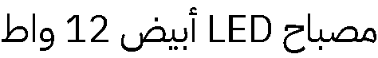

# Arabic labels

## On Zebra printers

Zebra and other label printers draw Arabic letters **unjoined and left to right**, so
`مصباح` prints as `ح ا ب ص م`. `text()` fixes that: it shapes the text, orders it right
to left, and sends it to the printer as a graphic (`^GF`). Latin-only text stays a
normal, sharp printer font (`^A0`).

[`examples/arabic.zpl`](https://github.com/aaltatan/qrbar-cli/blob/main/examples/arabic.zpl):

```text

^XA
^FO40,30{{ text(item.name_ar, size_mm=5) }}
^FO40,110{{ qr(item.url, size_mm=20) }}
^FO260,140^A0N,30,30^FD{{ item.sku }}^FS
^XZ
```

```bash
qrbar render -t arabic.zpl -d items.json
```

{ style="height:56px" }

- `size_mm` is the font size, 3 mm by default.
- Mixed text like `مصباح LED 12 واط` is drawn in one piece, in the right order.
- Arabic-Indic digits (`٢`) and Latin digits both work.
- The `^FO` in front of `text()` is the top-left corner of the text.

### Bilingual labels

A common layout is the Arabic name over the English name, both through `text()`:

```text

^XA
^FO40,30{{ text(item.name_ar, size_mm=5) }}
^FO40,90{{ text(item.name, size_mm=4) }}
^FO40,150{{ qr(item.url, size_mm=18) }}
^XZ
```

`text()` decides per value: the Arabic name becomes a graphic, and the English name a
printer font field.

### Fonts

The bundled font is **IBM Plex Sans Arabic** (SIL Open Font License). It covers Latin
as well, so mixed text looks consistent. Use your own TTF or OTF font with `--font`:

=== "Windows"

    ```text
    qrbar render -t arabic.zpl -d items.json --font "C:/Windows/Fonts/tahoma.ttf"
    ```

=== "Linux"

    ```text
    qrbar render -t arabic.zpl -d items.json --font /usr/share/fonts/truetype/noto/NotoNaskhArabic-Regular.ttf
    ```

`--font` only applies to ZPL templates.

!!! tip "Print size"
    A graphic is printed dot by dot, so thin fonts at small sizes can break up on a
    203 dpi printer. Keep Arabic at `size_mm=4` or more on 203 dpi, or use a bolder font.

## In Word

In Word templates Arabic **just works**: Word shapes the text itself, with the fonts and
right-to-left settings of your document. Write `{{ item.name_ar }}` in a paragraph set
to right-to-left, in the font you want.

## In codes

QR, Data Matrix, Aztec and PDF417 encode any UTF-8 text, Arabic included:

```bash
qrbar code qr "مصباح مكتب" -o arabic-qr.png
```

Code 128, EAN-13 and UPC-A are ASCII or digits only. See
[Code types](../reference/symbologies.md).
