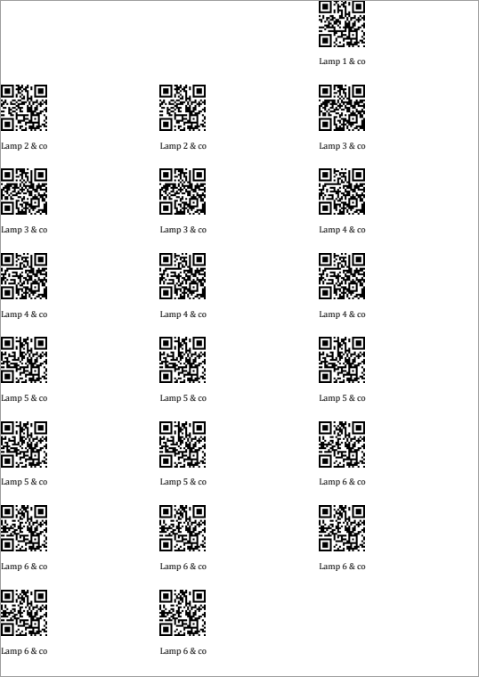

# First labels

This page takes you from nothing to three kinds of printed labels in a few minutes.
Open a terminal in the
[`examples/`](https://github.com/aaltatan/qrbar-cli/tree/main/examples) folder.

## The example files

| File | What it is |
|------|------------|
| `items.xlsx` / `items.json` | 4 products: `url`, `sku`, `ean`, `name`, `name_ar`, `category`, `qty` |
| `label.zpl` | A 203 dpi Zebra label: QR, Code 128, EAN-13 and a name |
| `small.zpl` | A small Zebra label: Code 128 and a name |
| `arabic.zpl` | A Zebra label with an Arabic name |
| `label.docx` | A 60 × 40 mm Word label, one per page |
| `sheet.docx` | An A4 sheet of 3 × 8 stickers (70 × 37 mm) |
| `item.schema.json` | A JSON Schema, to type records in |
| `bin.zpl` / `bins.json` | A 300 dpi warehouse bin label ([recipe](../recipes.md#warehouse-bin-labels)) |
| `asset.zpl` / `assets.json` | An IT asset tag ([recipe](../recipes.md#it-asset-tags)) |
| `erp.zpl` / `erp-export.json` | Price labels from an ERP export ([recipe](../recipes.md#labels-from-an-erp-export)) |

The data has four products:

| sku | name | category | qty |
|-----|------|----------|-----|
| LMP-001 | Desk lamp | lighting | 3 |
| LMP-002 | Floor lamp | lighting | 1 |
| BLB-010 | LED bulb | bulbs | 5 |
| CBL-200 | Cable 2m | cables | 0 |

So a full run prints **9 labels**: 3 + 1 + 5, and the cable (qty 0) is skipped.

## The three commands

| Command | Alias | Does |
|---------|-------|------|
| `render` | `r` | Template + data → labels (`.docx`, `.zpl`, `.prn`, `.pdf`) |
| `code` | `c` | One barcode or QR image (`.png`, `.svg`) |
| `symbologies` | `s` | List the code types and what each one accepts |

```text
qrbar --help
qrbar render --help
```

## Zebra labels

```bash
qrbar render -t label.zpl -d items.xlsx
```

```text
Written: .../examples/label-labels.zpl
```

The output is named after the template: `label.zpl` → `label-labels.zpl`. It holds one
`^XA ... ^XZ` block per product, and each block ends with `^PQ<qty>`, so the printer
prints the copies itself. Send it to the printer as shown in
[Recipes](../recipes.md#send-zpl-straight-to-a-zebra-printer).

!!! tip "No Zebra at hand?"
    Paste the ZPL into an online ZPL viewer such as
    [labelary.com/viewer.html](https://labelary.com/viewer.html) to see the labels.

## Word labels, one per page

```bash
qrbar render -t label.docx -d items.json -f first
```

```text
Written: .../examples/first.docx
```

`-f` sets the file name (without the extension). The document has 9 pages of
60 × 40 mm, one per copy, ready for a desktop label printer.

## An A4 sticker sheet

```bash
qrbar render -t sheet.docx -d items.xlsx -m sheet --rows 8 --cols 3
```

`-m sheet` lays the 9 copies out on a 3-across, 8-down grid. If the first 4 stickers
of your sheet are already used, skip them:

```bash
qrbar render -t sheet.docx -d items.xlsx -m sheet --rows 8 --cols 3 --skip 4 -f reuse
```

{ style="width:260px" }

## One code image

```bash
qrbar code qr "https://example.com/p/1"
```

```text
Written: .../examples/qr.png
```

## Running it twice

Run the first command again and qrbar stops:

```text
$ qrbar render -t label.zpl -d items.xlsx
Error: 1 file(s) exist: label-labels.zpl. Use --force to replace.
```

Nothing is ever overwritten by accident. Add `--force` to replace the file, or
`-f` / `-o` to write somewhere else.

## Next

Now write your own template: [Zebra (ZPL)](zpl.md) or [Word (docx)](word.md).
