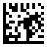
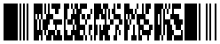
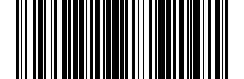
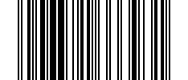

---
hide:
  - navigation
---

# qrbar-cli

**Print barcode and QR code labels from the command line.**

Point `qrbar` at a **template** (a Word `.docx`, or a Zebra `.zpl` / `.prn`) and your
**data** (an Excel sheet or a JSON file). You get label sheets, one label per page, or
ZPL that is ready to send to the printer. Word output can also be saved as PDF.

<p>
  
  
  
  
  
  
</p>

```bash
qrbar render -t label.zpl -d items.xlsx
```


## Why qrbar-cli

<div class="grid cards" markdown>

-   :material-palette-outline: **The template decides the look**

    ---

    `{{ qr(item.url, size_mm=25) }}` in the template picks the code type and its
    printed size. Your data only carries values.

-   :material-printer-outline: **Word or Zebra, same syntax**

    ---

    In Word a code becomes an image sized in millimetres. In ZPL it becomes the
    printer's own barcode command (`^BQ`, `^BC`, `^BX`, ...).

-   :material-counter: **Quantities built in**

    ---

    A `qty` column per row sets the copies: repeated pages in Word, `^PQ` in ZPL.
    `0` skips the row.

-   :material-grid: **Label sheets**

    ---

    A4 3 × 8 and friends, with `--skip` to reuse a sheet you already peeled some
    stickers off.

-   :material-translate: **Arabic on Zebra printers**

    ---

    Shaped, right-to-left text is drawn as a graphic, because label printers cannot
    join Arabic letters.

-   :material-shield-check-outline: **Safe by default**

    ---

    Existing files and the template are never overwritten without `--force`. Bad data
    is reported by row, and nothing is written.

</div>

## A taste

=== "Zebra printer"

    ```bash
    # one ZPL block per product, each printed qty times
    qrbar render -t label.zpl -d items.xlsx
    ```

=== "A4 sticker sheet"

    ```bash
    # 3 x 8 stickers, the first 4 already used
    qrbar render -t sheet.docx -d items.xlsx -m sheet --rows 8 --cols 3 --skip 4
    ```

=== "One file per product"

    ```bash
    # LMP-001.zpl, LMP-002.zpl, BLB-010.zpl
    qrbar render -t label.zpl -d items.json -m per_item -n sku -o zebra
    ```

=== "A single code"

    ```bash
    qrbar code qr "https://example.com/p/1"
    ```

## Where to go next

- New here? [Install it](install.md), then follow the [user guide](guide/index.md)
  from [your first labels](guide/first-labels.md) onwards.
- Have a job to do? See the [recipes](recipes.md): warehouse bins, IT asset tags,
  ERP exports, price stickers, printing straight to a Zebra.
- Looking up an option? The [reference](reference/index.md) lists every command,
  option, template function, code type, filter rule and error.

qrbar-cli is built on the [qrbar](https://github.com/aaltatan/qrbar) library. Data is
read with [pyrecords](https://github.com/aaltatan/pyrecords), the same reader
[templify](https://github.com/aaltatan/templify) uses.
