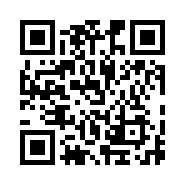
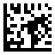
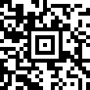
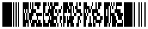
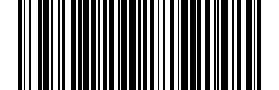
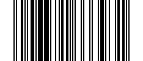
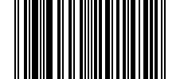

# Code types

qrbar has 7 built-in code types. Use their names in templates (`{{ qr(...) }}`) and
with `qrbar code <name>`.

| Name | Example | Image | Payload |
|------|---------|-------|---------|
| `qr` | `https://example.com/p/1` | { style="height:56px" } | Any text, UTF-8 (Arabic works); error correction level M |
| `datamatrix` | `LMP-001` | { style="height:56px" } | Any text, UTF-8; always square |
| `aztec` | `https://example.com/p/1` | { style="height:56px" } | Any text, UTF-8 |
| `pdf417` | `LMP-001 Desk lamp` | { style="height:40px" } | Any text, UTF-8 |
| `code128` | `LMP-001` | { style="height:40px" } | ASCII only |
| `ean13` | `400638133393` | { style="height:40px" } | 12 digits (check digit added) or 13 (check digit verified) |
| `upca` | `03600029145` | { style="height:40px" } | 11 digits, or 12 with a correct check digit |

## Which one to use

| You need | Use |
|----------|-----|
| A link people open with their phone | `qr` |
| Internal codes (SKU, bin, asset tag) read by a laser scanner | `code128` |
| A tiny code on a small part, or one readable when partly damaged | `datamatrix` |
| A product sold in shops (Europe, Middle East and most of the world) | `ean13`, with a GS1-registered number |
| A product sold in shops in the US and Canada | `upca`, with a GS1-registered number |
| A lot of text in a long, flat code (IDs, shipping documents) | `pdf417` |
| Tickets and boarding passes, a dense square code with no white margin | `aztec` |

!!! info "Retail barcodes are registered"
    EAN-13 and UPC-A numbers for products sold in shops come from
    [GS1](https://www.gs1.org). Do not make them up: two products with the same number
    break the till. For your own stock, use Code 128 or Data Matrix with your own codes.

## Check digits

EAN-13 and UPC-A end with a check digit that scanners use to catch misreads.

- Give **12 digits** for EAN-13 (or 11 for UPC-A) and qrbar adds the check digit.
- Give **13 digits** (or 12) and qrbar checks it. A wrong one is an error that tells
  you the right digit:

```text
$ qrbar code ean13 4006381333932
Error: ean13: invalid payload '4006381333932', wrong check digit, expected 1.
```

!!! warning "Leading zeros in Excel"
    `012345678905` typed into a number cell becomes `12345678905`, one digit short.
    Format EAN and UPC columns as **Text** in Excel before typing them.

## Payload errors

A payload a code cannot hold stops the run before anything is written:

```text
$ qrbar code upca 12345
Error: upca: invalid payload '12345', must be 11 or 12 digits.

$ qrbar code code128 "مصباح"
Error: code128: invalid payload 'مصباح', only ASCII characters are allowed.
```

In `render`, the message names the record: `Record 1: code128: invalid payload '', must
not be empty.`

## Custom code types

Other types (Code 39, ITF-14, ...) can be added to the
[qrbar](https://github.com/aaltatan/qrbar#custom-code-types) library in Python. The
command line uses the 7 built-in types.
